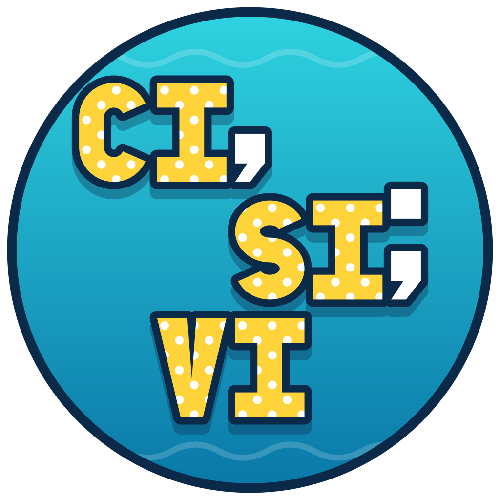

<p align="center">
  
</p>

# Cisivi

[](https://github.com/partoska/cisivi/releases/tag/v1.0.1)
[](LICENSE.txt)
[](https://github.com/partoska/cisivi/actions/workflows/build.yml)
[](https://www.npmjs.com/package/@partoska/cisivi)

Small, minimal CSV library and query tool, in plain ISO C99.

- **cisivi** queries, filters, sorts and edits CSV files from the command
  line, so that shell scripts and pipelines handle tables safely, quoted
  commas and line breaks included.
- **libcisivi** reads and writes CSV with optional headers, any delimiter
  and no type conversion, keeps rows and columns in file order and never
  prints to stdout or stderr.

## Features

- Queries for columns by name or position, rows by position or range (also
  from the end), or single values.
- Filters on column values: text equality, numeric or text order, and
  containment, combined as needed.
- Sorting by a column, numbers by value, stable.
- Output as CSV, raw values one per line (or NUL-separated), JSON, or an
  aligned table for reading.
- Column names and row counts that line breaks inside values do not upset.
- Several files joined in order, columns matched by name.
- Setting values (adding the column when missing), appending rows and
  deleting rows or columns, printed or written back in place.
- Semicolon, tab or any other delimiter, read and written; LF or CRLF.
- Exit codes for scripts: `0` found, `1` not found, `2` usage or input error.
- Output in CSV is valid CSV, ready for another `cisivi`.
- A dependency-free C library behind it, with stream callbacks for any source.

## Supported Platforms

| OS      | Architectures                                |
| ------- | -------------------------------------------- |
| macOS   | Universal (Intel & Apple Silicon), macOS 11+ |
| Linux   | amd64, arm64, armhf (ARMv6+)                 |
| Windows | amd64, arm64                                 |

## Installation

### Homebrew (macOS, Linux amd64/arm64)

```bash
brew install partoska/tap/cisivi
```

### Scoop (Windows)

```powershell
scoop bucket add partoska https://github.com/partoska/scoop-bucket
scoop install partoska/cisivi
```

### npm (macOS, Linux amd64/arm64, Windows)

```bash
npm install -g @partoska/cisivi
```

### Packages and binaries

Every [GitHub release](https://github.com/partoska/cisivi/releases) ships a
macOS `.pkg` installer, Linux `.deb` (amd64, arm64, armhf) and `.rpm` (amd64,
arm64) packages, Windows `_setup.exe` (amd64, arm64) and `.msi` (amd64)
installers, `.tar.gz` and `.zip` archives, bare binaries, and a `SHA256SUMS`
file. The packages also hold `libcisivi` with its headers and pkg-config file.
For example, on Raspberry Pi OS (32-bit):

```bash
sudo apt install ./cisivi_<version>_linux_armhf.deb
```

### Build from source

Prerequisites: CMake 3.20+ and a C99 compiler (GCC, Clang, or MSVC).

```bash
git clone https://github.com/partoska/cisivi && cd cisivi
./build.sh
sudo ./install.sh
```

Without CMake, `make && sudo make install` builds and installs the tool and the
static library.

### Agent skill

An agent skill teaches AI coding agents how to drive the `cisivi` CLI (queries,
filters, sorting, output formats, editing, and exit codes). Its source is in
[`skills/cisivi/`](skills/cisivi/SKILL.md). Install it into your agent (Claude
Code, Codex, Cursor, and others) with:

```bash
npx skills add partoska/cisivi
```

Every release also ships `cisivi_<version>_skill.zip`, which can be uploaded as
a custom skill in Claude.

## Usage

```
cisivi [OPTIONS] [QUERY] [FILE...]
```

Reads `FILE`, or standard input when `FILE` is missing or `-`, and prints
what `QUERY` selects. The first row names the columns. The query always comes
first, so the whole table of a file is `cisivi . crew.csv`.

| Query | Prints |
|---|---|
| `.` (default) | the whole table, as CSV |
| `COLUMN` | the values of one column, one per line |
| `COLUMN,COLUMN,...` | those columns, as CSV |
| `#N` | a column by position, from `0` |
| `[ROWS]` | rows by position, as CSV: `[N]`, `[-N]` from the end, `[N:M]` from `N` up to `M`, `[N:]`, `[:M]`, `[*]` |
| `[ROWS].COLUMN,...` | both, such as `[0].name` for one value |

A leading dot is optional (`.[0].name`). Names may contain spaces and dots;
quote a name with commas or quotes, `'"last, first"'`, where `\"` and `\\`
escape. Unquoted, the whole text is tried as one name first, so a column
named `b,c` is found without quotes too.

```sh
$ cat crew.csv
id,name,rank,age,ship
1,Kirk,Captain,34,Enterprise
2,Spock,Commander,35,Enterprise
3,"McCoy, Leonard",Doctor,52,Enterprise
4,Janeway,Captain,41,Voyager
$ cisivi name crew.csv
Kirk
Spock
McCoy, Leonard
Janeway
$ cisivi '[-1].name' crew.csv
Janeway
$ cisivi '[1:3].name,ship' crew.csv
name,ship
Spock,Enterprise
"McCoy, Leonard",Enterprise
$ for ship in $(cisivi ship crew.csv | sort -u); do ...; done
```

### Filtering and sorting

`-f` / `--filter` keeps the rows where `COLUMN OPERATOR VALUE` holds; several
filters must all hold. `=` and `!=` compare text exactly, `<`, `<=`, `>` and
`>=` compare numbers by value and other text byte by byte, `~` and `!~` look
for the value inside. `--sort COLUMN` and `--sort-desc COLUMN` order the rows,
numbers by value, keeping the order of equal ones. Rows of the query are
counted after filtering and sorting, so `[0]` is the first match.

```sh
$ cisivi -f ship=Voyager -f 'age>=40' name crew.csv
Janeway
$ cisivi --sort-desc age '[0].name' crew.csv
McCoy, Leonard
$ cisivi -f 'name~o' -c . crew.csv
2
```

`-c` / `--count` prints the number of rows selected, and `-k` / `--keys` the
column names, one per line; both count records, not lines, so values with
line breaks do not upset them.

### Output

CSV by default, written with the delimiter it was read with and LF line
endings; values come out raw when the query names one column. `-j` /
`--json` prints an array with an object per row (an array per row without a
header), `-t` / `--table` an aligned table for reading, with line breaks
shown as `\n`. `-0` / `--null` ends raw values and names with NUL instead of
a newline, for `xargs -0`.

```sh
$ cisivi -t -f ship=Enterprise id,name,age crew.csv
id  name            age
--  --------------  ---
1   Kirk            34
2   Spock           35
3   McCoy, Leonard  52
$ cisivi -j '[0].name,rank' crew.csv
[
  {"name": "Kirk", "rank": "Captain"}
]
$ cisivi -0 name crew.csv | xargs -0 -n1 echo
```

`-F` / `--delimiter C` reads fields separated by `C`, such as `;` or `tab`;
`--output-delimiter C` writes another one, and `--crlf` ends rows with CRLF.
`-n` / `--no-header` reads the first row as data, its columns addressed as
`#N`.

```sh
$ cisivi -F ';' --output-delimiter , . export.csv > clean.csv
$ cisivi --output-delimiter tab . crew.csv > crew.tsv
```

Several files are joined in order, their columns matched by name: a column
new in a later file is added, and rows that lack it leave it empty. Without
a header, rows are appended and must be as wide as the first.

```sh
$ cisivi -c . january.csv february.csv march.csv
```

### Editing

`-s VALUE` / `--set VALUE` sets one column of the selected rows (all rows
without `[ROWS]` or a filter), adding the column when missing. `-a ROW` /
`--add ROW` appends one record, given as CSV text, or with `[N]` inserts it
as row `N` (`[-1]` before the last row). `-d` / `--delete` deletes the
selected rows, or the columns the query names. The edited table goes to
standard output, or with `-w` / `--write` back to its file, which needs
exactly one `FILE`. An edit that selects nothing exits with `1`; the table is
still printed, but a `-w` leaves the file untouched.

```sh
$ cisivi -w -s Admiral -f name=Kirk rank crew.csv
$ cisivi -w -a '5,Seven,"Astro, metrics",9,Voyager' . crew.csv
$ cisivi -w -a '0,Pike,Captain,38,Enterprise' '[0]' crew.csv
$ cisivi -d -f 'age<18' . crew.csv > adults.csv
$ cisivi -w -d notes,draft crew.csv
```

The file is rewritten in place, so it keeps its permissions and links.

Other options: `-i` / `--ignore-case` matches column names ASCII
case-insensitively, `-h` / `--help`, `-V` / `--version`.

Exit status: `0` found, `1` not found (a missing column, or no row selected;
the header is still printed, so the output stays valid CSV), `2` usage or
input error (including CSV syntax errors, reported with their line on
standard error).

## Library

```c
#include <cisivi.h>

CSCsv *csv = csInit (CS_FHEADER);
if (csLoad (csv, "crew.csv") != CS_OK)
  {
    fprintf (stderr, "%s\n", csError (csv)->message);
  }
CSSize name = csColumnFind (csv, "name");
for (CSSize i = 1; i < csRowCount (csv); ++i)
  {
    puts (csGet (csv, i, name));
  }

csSet (csv, 1, name, "James T. Kirk");
csSave (csv, "crew.csv");
csDestroy (csv);
```

The format:

```csv
id,name              Fields are separated by commas; spaces count.
1,"a, ""b"""         Quoted fields may hold commas, doubled quotes
2,"two               and line breaks.
lines"
3,""                 An explicitly quoted empty string is one field.
```

CRLF, LF and CR end records and blank lines are skipped. Every row has as
many fields as the first; with `CS_FHEADER` the first row holds unique,
non-empty column names and stays row `0`. `CS_FICASE` matches names
ASCII case-insensitively, `CS_FLF` turns line breaks inside values into LF.
No type conversion takes place.

Streams go through callbacks, so any source works: `csRead` pulls text from
a `CSReadFn` (standard input, a socket, memory) and `csWrite` pushes it to a
`CSWriteFn`; `csLoad` and `csSave` are the file versions.

```c
static CSSize
readStdin (CSVoid *user, CSChar *data, CSSize size)
{
  CSSize n = fread (data, 1, size, stdin);
  return n == 0 && ferror (stdin) ? CS_READ_ERROR : n;
}

csRead (csv, readStdin, NULL);
```

`csSetDelimiter` chooses the field separator for reading and writing (`,` by
default, e.g. `';'` or `'\t'`), `csSetNewline` what ends written rows
(`"\r\n"` by default, or `"\n"`). `csRowAdd` and `csRowRemove` append and
remove rows, `csRowInsert` puts one at a position, `csRowRemoveMany`
removes several in one pass. `csColumnAdd`, `csColumnInsert` and
`csColumnRemove` do the same for columns, a new one filled with a given
value (`NULL` for empty fields). Writing quotes only the fields that need it; `csWriteRow` writes a single record in a document's settings,
for rows produced one at a time. See `src/lib/inc/cisivi.h` for the whole
API.

Link with `pkg-config --cflags --libs cisivi`, or in CMake add this
repository with `add_subdirectory` and link the `cisivi` target.

## Building

Requirements: a C99 compiler and CMake 3.20 or later.

```sh
./build.sh                # Release build into ./build
./build.sh -d -t          # Debug build with tests
./build.sh -s -t          # Sanitizers (address, undefined; integer on Clang)
./build.sh -p             # Packages into dist/ (CPack)
./test.sh                 # Run the registered tests (does not build)
./install.sh              # cmake --install: bin/cisivi, lib/libcisivi.a,
                          # include/, pkg-config, docs
```

CMake options: `BUILD_SHARED_LIBS` (shared `libcisivi`), `WITH_CLI` (default
on), `WITH_TESTS`, `WITH_SANITIZERS`. `make help` lists the targets and options
of the plain `Makefile`.

On Windows, build with MSVC (Visual Studio 2015 or later) or MinGW-w64; the
scripts run in Git Bash or MSYS2, `test_cli` needs their `sh`. Executables and
DLLs go to `build/bin`, and `./build.sh -p` makes a ZIP, plus NSIS and WiX
installers when `makensis` and the WiX toolset are installed. With MSVC the
library is named `libcisivi` (`libcisivi.lib`, `libcisivi.dll`), and
sanitizers are not supported. The `cisivi` tool reads and writes its standard
streams in binary mode, so it prints LF line endings as it does elsewhere.

## Contributing

Contributions are welcome — see [CONTRIBUTING.md](CONTRIBUTING.md). To report a
security issue, follow [SECURITY.md](SECURITY.md).

## License

This project is licensed under the [MIT License](LICENSE.txt).

## Contact

Project website: <https://lab.partoska.com/cisivi>. You can contact the
author(s) via email at ask <at> partoska.com.

## Copyright

Copyright (C) 2026 Fabrika Charvat s.r.o. All rights reserved.
Developed by Partoska Laboratory team, &lt;<https://lab.partoska.com>&gt;
